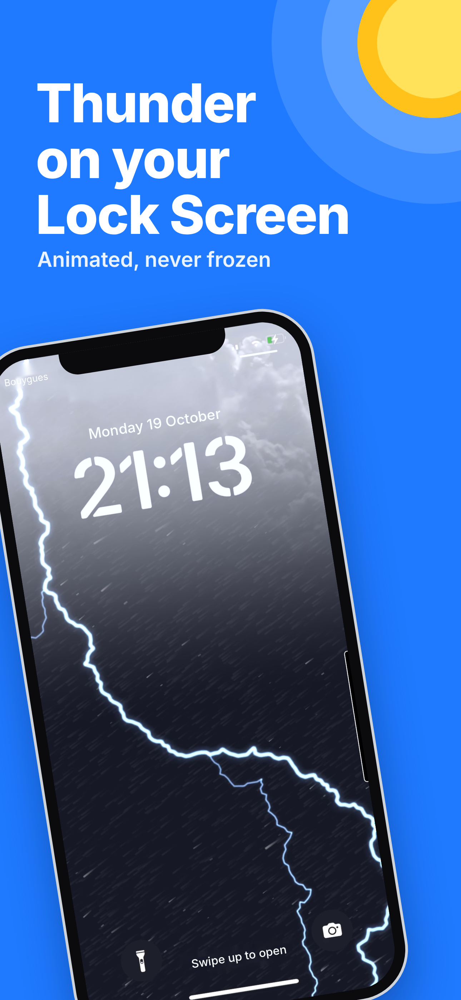
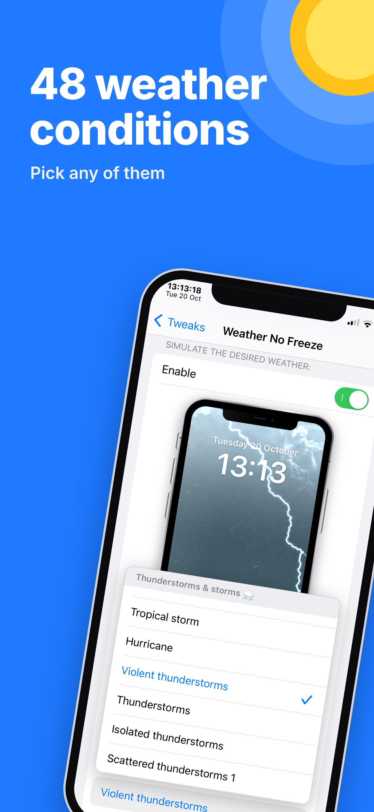
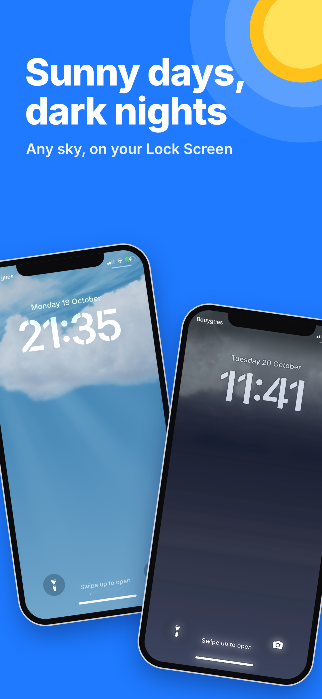
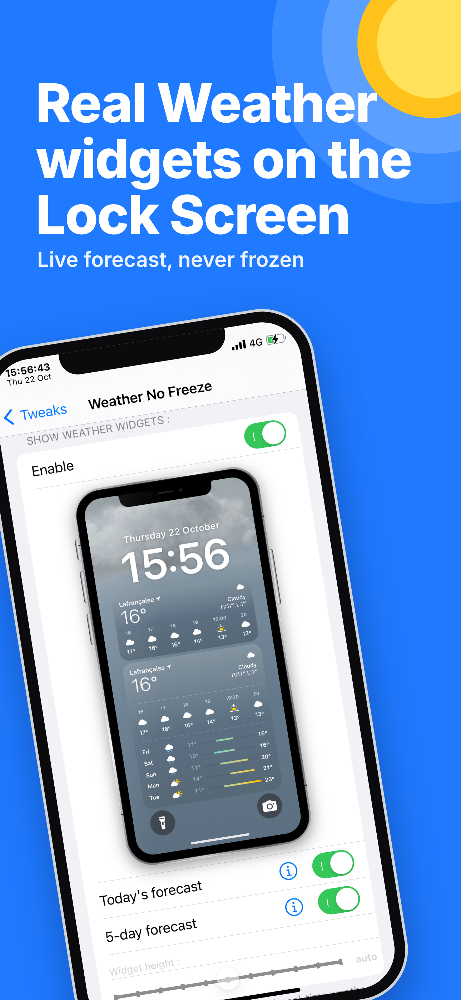
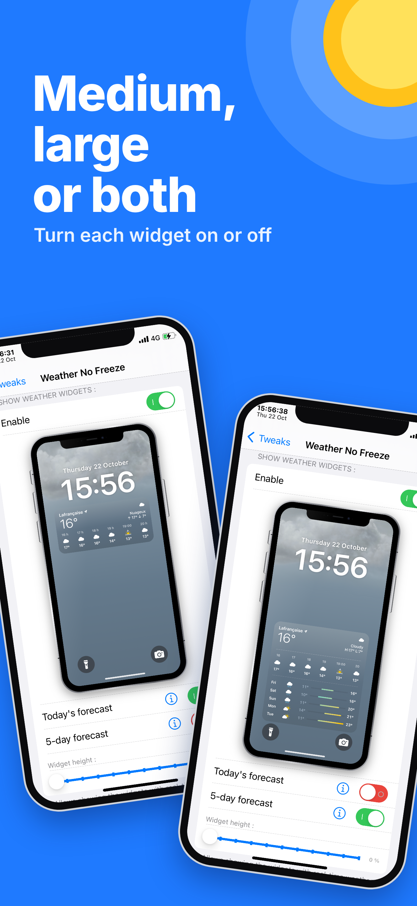
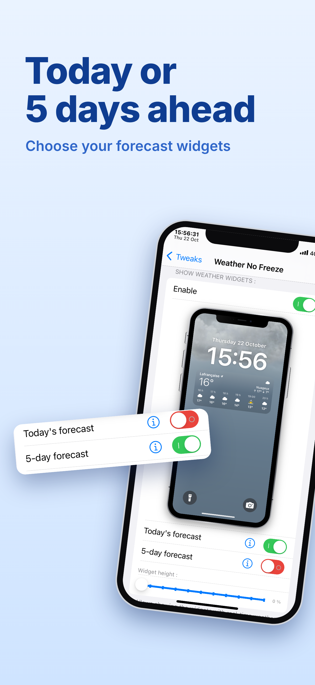
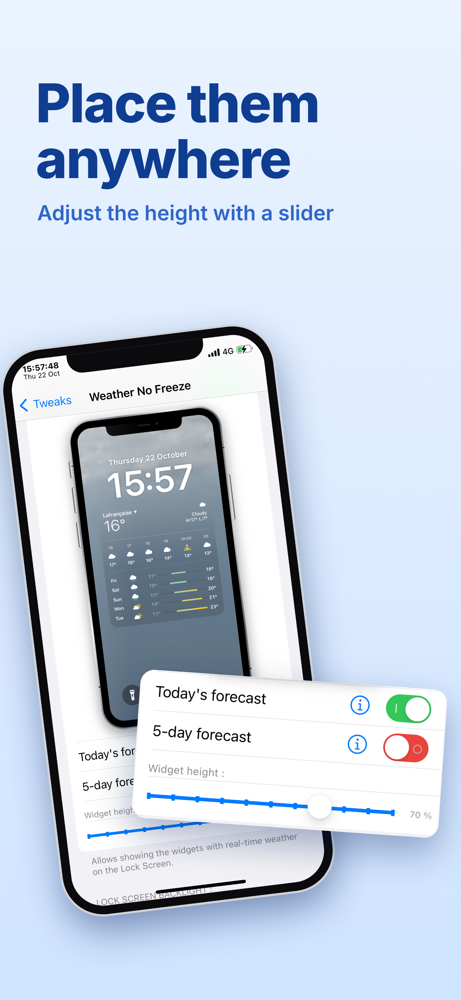
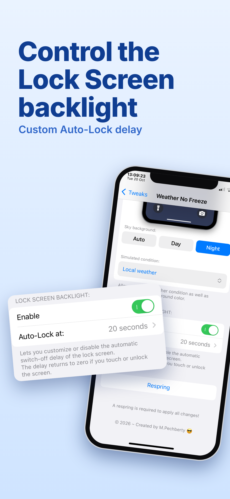

  

# Weather No Freeze

**🇬🇧 English** · [🇫🇷 Français](#-français)

**Weather No Freeze !** the successor to **Forecast**, **WeatherBoard**, **Asteroid**, and **WeatherGround** is finally here for iOS 16 !

Stops the Weather wallpaper from freezing on your Lock Screen & Home Screen and even more !

> 🛒 **Havoc shop :** [https://havoc.app/package/weathernofreeze](https://havoc.app/package/weathernofreeze)

# ***Features* :**

**• Unfreeze the Weather wallpaper :**
- Disables the freezing of the animations on the Weather wallpaper (Lock Screen & Home Screen).

**• Animation speed :**
- Adjust the speed with a slider, up to 10 times faster ! (The iOS default is 1.00).

**• Simulate the weather you want :**
- Force any weather condition (48 to choose from, or keep your local weather).
- Force the sky background to Auto, Day or Night.

**• Weather widgets on the Lock Screen :**
- Display the real Weather widgets with real-time weather on your Lock Screen : Today's forecast, 5-day forecast, or both at once.
- Turn each widget on or off separately, and adjust the height of the widget with a slider.

**• Lock Screen backlight :**
- Customize or disable the Auto-Lock delay of the Lock Screen (The delay resets when you touch or unlock the screen).

**• 10 languages :**

English, French, Spanish, German, Italian, Portuguese, Dutch, Russian, Simplified Chinese and Japanese.

# ***Settings live in* :**

**Settings --› Weather No Freeze** (A respring is not needed to apply all changes).

# ***Screenshots* :**

  
  
  
  

# ***Compatibility* :**

- iOS : 16 --> 16.7.XX

- Jailbreak : Rootless

- Requires : PreferenceLoader

- Tested only on : iPhone X - iOS 16.7.12

# ***Other iPhones or other iOS versions ? :***

Help me test other devices !

If you try Weather No Freeze on another iPhone or other iOS versions, please tell me if it works (model + iOS version = works, doesn't work or bug) :

https://github.com/MPechberty/WeatherNoFreeze/issues

# ***Support* :**

**Report an issue on GitHub :** 

https://github.com/MPechberty/WeatherNoFreeze/issues

© 2026 – Created by M.Pechberty

---

---

## 🇫🇷 Français

**Weather No Freeze !** le successeur de **Forecast**, **WeatherBoard**, **Asteroid** et **WeatherGround** enfin sur iOS 16 !

Empêche le fond d'écran Météo de se figer sur ton Lock Screen & Home Screen et plus encore !

> 🛒 **Boutique Havoc :** [https://havoc.app/package/weathernofreeze](https://havoc.app/package/weathernofreeze)

# ***Fonctions* :**

**• Dégeler le fond d'écran Météo :**
- Désactive le gel des animations sur le fond d'écran Météo (Lock Screen & Home Screen).

**• Vitesse de l'animation :**
- Règle la vitesse avec un curseur, jusqu'à 10 fois plus vite ! (Par défaut, iOS utilise 1.00).

**• Simuler le temps souhaité :**
- Force n'importe quelle condition météo (48 au choix, ou ta météo locale).
- Force le fond du ciel en Auto, Jour ou Nuit.

**• Widgets Météo sur le Lock Screen :**
- Affiche les vrais widgets Météo avec la météo en temps réel sur ton Lock Screen : Prévisions du jour, Prévisions sur 5 jours, ou les deux en même temps.
- Active chaque widget séparément et règle la hauteur du widget avec un curseur.

**• Rétro-éclairage du Lock Screen :**
- Personnalise ou désactive le délai d'extinction automatique de l'écran de verrouillage (Le délai revient à zéro si tu touches ou déverrouilles l'écran).

**• 10 langues :**

anglais, français, espagnol, allemand, italien, portugais, néerlandais, russe, chinois simplifié et japonais.

# ***Les réglages sont dans* :**

**Réglages --› Weather No Freeze** (Un respring n'est pas obligatoire pour appliquer tous les changements).

# ***Captures d'écran* :**

  
  
  
  

# ***Compatibilité* :**

- iOS : 16 --> 16.7.XX

- Jailbreak : Rootless

- Nécessite : PreferenceLoader

- Testé seulement sur : iPhone X - iOS 16.7.12

# ***Autres iPhone ou autres versions d'iOS ? :***

Aide-moi à tester d'autres appareils !

Si tu essaies Weather No Freeze sur un autre iPhone ou une autre version d'iOS, merci de me dire s'il fonctionne (modèle + version d'iOS = fonctionne, fonctionne pas ou bug) :

https://github.com/MPechberty/WeatherNoFreeze/issues

# ***Support* :**

**Signaler un problème sur GitHub :**

https://github.com/MPechberty/WeatherNoFreeze/issues

© 2026 – Créé par M.Pechberty
