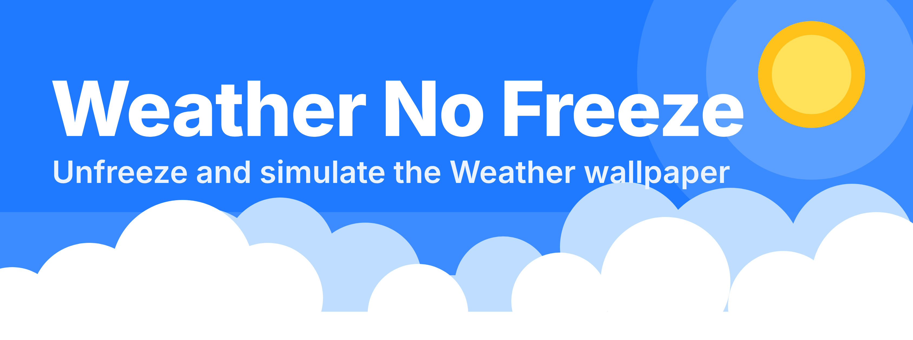
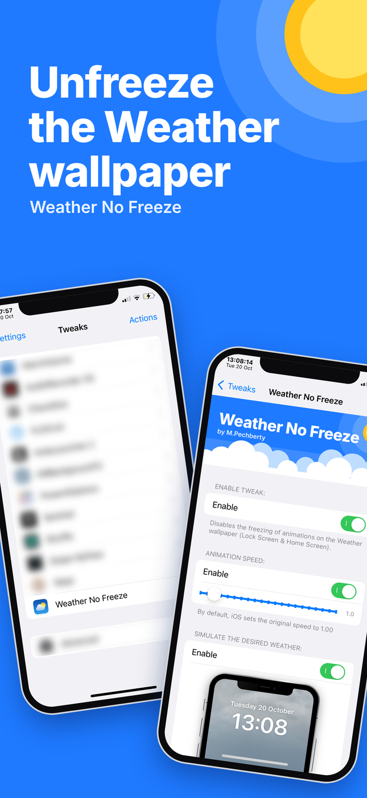
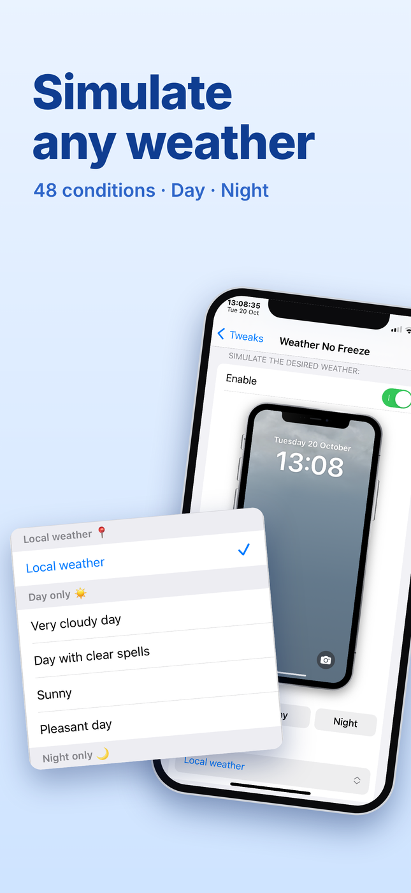
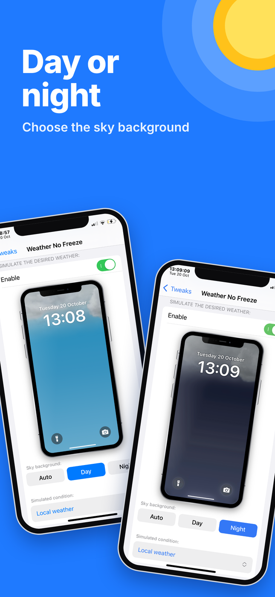
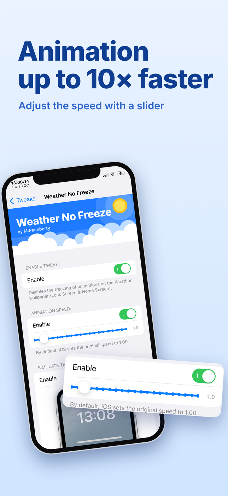
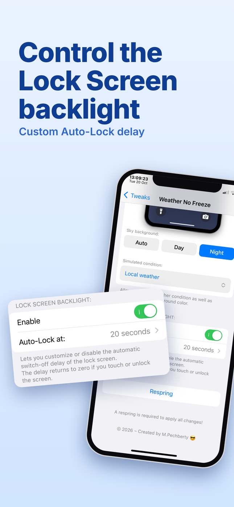
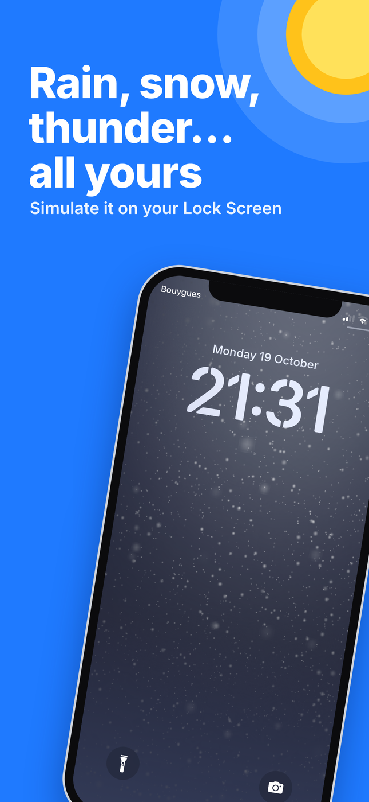

  

# Weather No Freeze

**🇬🇧 English** · [🇫🇷 Français](#-français)

**Weather No Freeze !** the successor to **Forecast**, **WeatherBoard**, **Asteroid**, and **WeatherGround** is finally here for iOS 16 !  
Stops the Weather wallpaper from freezing on your Lock Screen & Home Screen and even more !

> 🛒 **Get it on Havoc:** _link coming soon_

## Features

• **Unfreeze the Weather wallpaper** : 
- Disables the freezing of the animations on the Weather wallpaper (Lock Screen & Home Screen).

• **Animation speed** : 
- Adjust the speed with a slider, up to 10 times faster ! (The iOS default is 1.00).

• **Simulate the weather you want** : 
- Force any weather condition (48 to choose from, or keep your local weather). 
- Force the sky background to Auto, Day or Night.

• **Lock Screen backlight** : 
- Customize or disable the Auto-Lock delay of the Lock Screen (The delay resets when you touch or unlock the screen).

• **10 languages** : 
English, French, Spanish, German, Italian, Portuguese, Dutch, Russian, Simplified Chinese and Japanese.

• Settings live in : 
**Settings** --› **Weather No Freeze** (A respring is not needed to apply all changes).

## Screenshots

   
   
   

## Compatibility

| | |
|---|---|
| iOS | 16 --> 16.7.XX |
| Jailbreak | Rootless |
| Requires | PreferenceLoader |
| Tested on | iPhone X - iOS 16.7.12 |

## Support

[Report an issue on GitHub](https://github.com/MPechberty/WeatherNoFreeze/issues)

© 2026 – Created by M.Pechberty

---

## 🇫🇷 Français

**Weather No Freeze !** le successeur de **Forecast**, **WeatherBoard**, **Asteroid** et **WeatherGround** enfin sur iOS 16 !  
Empêche le fond d'écran Météo de se figer sur ton Lock Screen & Home Screen et plus encore !

> 🛒 **À récupérer sur Havoc :** _lien bientôt disponible_

### Fonctions

• **Dégeler le fond d'écran Météo** : 
- Désactive le gel des animations sur le fond d'écran Météo (Lock Screen & Home Screen).

• **Vitesse de l'animation** : 
- Règle la vitesse avec un curseur, jusqu'à 10 fois plus vite ! (Par défaut, iOS utilise 1.00).

• **Simuler le temps souhaité** : 
- Force n'importe quelle condition météo (48 au choix, ou ta météo locale). 
- Force le fond du ciel en Auto, Jour ou Nuit.

• **Rétro-éclairage du Lock Screen** : 
- Personnalise ou désactive le délai d'extinction automatique de l'écran de verrouillage (Le délai revient à zéro si tu touches ou déverrouilles l'écran).

• **10 langues** : 
anglais, français, espagnol, allemand, italien, portugais, néerlandais, russe, chinois simplifié et japonais.

• Les réglages sont dans : 
**Réglages** --› **Weather No Freeze** (Un respring n'est pas obligatoire pour appliquer tous les changements).

### Captures d'écran

   
   
   

### Compatibilité

| | |
|---|---|
| iOS | 16 --> 16.7.XX |
| Jailbreak | Rootless |
| Nécessite | PreferenceLoader |
| Testé sur | iPhone X - iOS 16.7.12 |

### Support

[Signaler un problème sur GitHub](https://github.com/MPechberty/WeatherNoFreeze/issues)

© 2026 – Créé par M.Pechberty
